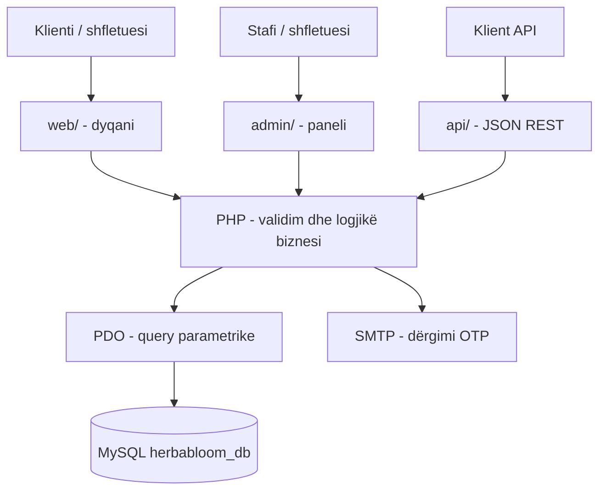
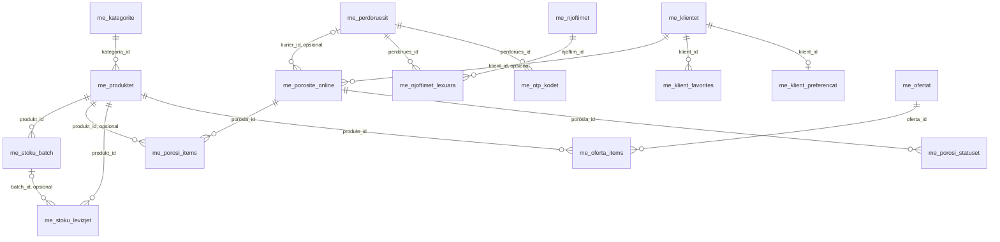

# Raporti Teknik 1 – Analiza, kërkesat dhe dizajni teknik

**Projekti:** HerbaBloom – Sistemi për menaxhimin e barnatores bimore
**Studentja:** Vesa Kastrati

> Ky dokument përmbledh dizajnin dhe funksionet e projektit aktual. README-ja dhe ky dokument ndihmojnë për përgatitjen e raportit; demonstrimi i drejtpërdrejtë i artefakteve me profesorin do të bëhet gjatë prezantimit.

## 1. Problemi dhe përdoruesit

Menaxhimi i produkteve, loteve të stokut dhe porosive në mënyrë të ndarë mund të shkaktojë gabime në sasi, skadenca dhe status të dërgesave. HerbaBloom i bashkon këto procese në një aplikacion web për dyqanin dhe stafin.

Përdoruesit kryesorë janë:

- **Klientët**, që shohin katalogun, bëjnë porosi, ndjekin porosinë me kod dhe dërgojnë mesazhe.
- **Administratori**, që administron stafin, konfigurimin global, raportet dhe proceset e dyqanit.
- **Farmacisti**, që administron produkte/stok, porosi dhe mesazhe, pa qasje në raportet financiare.
- **Kurieri**, që sheh dhe përditëson vetëm dërgesat e caktuara sipas rrjedhës së porosisë.

## 2. Kërkesat funksionale

| ID | Kërkesa | Kriteri i verifikimit |
|---|---|---|
| FR-01 | Stafi kyçet me username dhe fjalëkalim; OTP dërgohet me email. | Fjalëkalimi i gabuar refuzohet; OTP i vlefshëm hap sesionin. |
| FR-02 | Administratori dhe farmacisti menaxhojnë produktet dhe lotet e stokut. | Sasia dhe skadenca ruhen te batch-et; stoku i vlefshëm lexohet nga pamja `me_produktet_stoku`. |
| FR-03 | Klienti mund të shfletojë produktet dhe të krijojë porosi online. | Porosia ruan artikujt, gjeneron kod gjurmimi dhe rezervon stok. |
| FR-04 | Stafi përpunon porositë dhe cakton kurier. | Ndryshimet ndjekin statuset e lejuara dhe regjistrohen në historikun e statusit. |
| FR-05 | Kurieri sheh vetëm porositë që i janë caktuar. | Kërkesa për porosi të pak caktuar refuzohet. |
| FR-06 | Klienti mund të kërkojë statusin me kod gjurmimi dhe të dërgojë mesazh. | Kodi i vlefshëm gjen porosinë; mesazhi ruhet te `me_mesazhet`. |
| FR-07 | Administratori menaxhon stafin dhe cilësimet globale. | Rolet jo-admin kanë qasje vetëm-lexim ose nuk kanë qasje, sipas faqes. |
| FR-08 | Sistemi paraqet raporte financiare vetëm për administratorin. | Farmacisti dhe kurieri nuk marrin fushat financiare në pamjet/API-në e stafit; gjurmimi publik kthen përmbledhjen e porosisë për klientin. |
| FR-09 | Anulimi i porosisë rikthen stokun në batch-et fillestare. | Transaksioni regjistron lëvizje të tipit anulim dhe nuk lejon gjendje të pjesshme. |
| FR-10 | Klienti mund të krijojë llogari, të shohë porositë e veta dhe të ruajë produkte të preferuara. | Llogaria lidhet me porositë përmes `klient_id`; endpoint-et e klientit kërkojnë sesion dhe veprimet e shkrimit token CSRF. |
| FR-11 | Klienti mund të zgjedhë preferencat për njoftime; administratori mund të konfigurojë sete/oferta me produkte të katalogut. | Pëlqimet dhe përbërja e seteve ruhen në databazë; çmimet dhe përbërësit validohen në server. |
| FR-12 | Dyqani paraqet katalog, kërkim, sete/oferta dhe bestseller-a. | Produktet dhe ofertat lexohen nga databaza; bestseller-at bazohen në shitje të porosive të dorëzuara. |
| FR-13 | Administratori mund të caktojë imazhe për produkte dhe oferta; dyqani mund të përdorë gjithashtu asete lokale. | URL-ja ruhet në kolonën përkatëse dhe faqet përdorin imazhin ose placeholder-in kur mungon. |

## 3. Kërkesat jofunksionale

- **NFR-01 – Mbrojtja e hyrjes:** Fjalëkalimet ruhen me hash; OTP ka skadim dhe kufi tentativash.
- **NFR-02 – Siguria e query-ve:** Vlerat e përdoruesit lidhen si parametra në PDO; nuk bashkohen në SQL si tekst.
- **NFR-03 – Siguria e sesionit:** Përdoret cookie `HttpOnly`, `SameSite=Lax`, sesion i rinovuar pas autentikimit dhe afat pasiv 30 minuta.
- **NFR-04 – Autorizimi:** Roli kontrollohet në server për çdo faqe/API-veprimi; kufizimi nuk mbështetet vetëm në ndërfaqe.
- **NFR-05 – Daljet HTML:** Vlerat e paraqitura në HTML kalojnë përmes `htmlspecialchars`.
- **NFR-06 – Integriteti i stokut:** Rezervimi dhe kthimi i stokut ekzekutohen në transaksione dhe regjistrohen në lëvizje.
- **NFR-07 – Konfigurimi:** Fjalëkalimet SMTP dhe konfigurimi DB jepen nga variablat e mjedisit, jo nga skedarët e versionuar.

## 4. Teknologjitë dhe arsyetimi

- **PHP 8 dhe PDO:** përdoren për logjikën e biznesit, validimin dhe qasjen parametrike në databazë; përshtaten me ambientin ekzistues Laragon.
- **MySQL 8:** ruan entitete relacionale me çelësa primarë, indekse, kufizime dhe transaksione.
- **HTML/CSS/JavaScript:** ndërtojnë dyqanin dhe panelin pa framework shtesë; CSS siguron paraqitjen responsive dhe temën pastel.
- **PHPMailer/SMTP:** përdoret për kodet OTP të hyrjes së stafit.
- **API REST me JSON:** mundëson komunikim të strukturuar për klientë të jashtëm, me kode HTTP dhe validim të ndarë nga paraqitja HTML.

## 5. Arkitektura

`db.php` inicializon sesionin, ndihmësit e sigurisë dhe një lidhje PDO. Faqet admin/web dhe API përdorin këtë lidhje. Ndarja e shtresave është logjike: ndërfaqja dërgon HTTP, PHP zbaton rregullat e biznesit dhe MySQL ruan të dhënat.

## 6. Modeli konceptual i të dhënave

Entitetet kryesore dhe lidhjet e deklaruara në databazën lokale janë:

- `id` është çelës primar në tabelat përkatëse; tabela `me_njoftimet_lexuara` përdor çelës të përbërë (`njoftim_id`, `perdorues_id`).
- Skema lokale vendos vlera unike për `sku`, `slug`, `username` dhe `kodi_gjurmimit`; batch-i ka unikësinë për çiftin (`produkt_id`, `nr_batch`).
- `me_porosi_items` lidh porositë me produktet dhe ruan emrin/çmimin historik të produktit në momentin e porosisë.
- `me_stoku_batch` është burimi i sasive dhe datave të skadencës; pamja `me_produktet_stoku` llogarit stokun e vlefshëm.
- `me_stoku_levizjet` ruan ngjarjet e stokut. Në skemën lokale `porosia_id` dhe `nga_user_id` nuk shfaqen si foreign key të deklaruara.

**Shënim për saktësinë:** Skema lokale dokumentohet te `database/schema.sql` dhe përmban strukturën aktuale `me_`, përfshirë tabelën `me_web_design`, pa rreshta të katalogut, porosive apo llogarive. Për databazat ekzistuese, migrimi `001_customers_and_offers.sql` shton llogaritë/ofertat dhe lidhjen opsionale të porosive me klientët; migrimi `002_offer_images.sql` shton `me_ofertat.imazhi` nëse mungon; migrimi `003_visual_design_studio.sql` krijon tabelën e konfigurimit të dizajnit. Ekzekuto vetëm migrimet që mungojnë. Imazhet e produktit përdorin `me_produktet.imazhi`.

## 7. Fusha e projektit dhe kalimi në Raportin 2

Fusha aktuale përfshin panelin e ridizajnuar të stafit, dyqanin responsive, API-në, porositë, menaxhimin e batch-eve, njoftimet, cilësimet, llogaritë e klientëve, të preferuarat, preferencat, bestseller-at, asetet vizuale, setet/ofertat dhe Visual Design Studio. Studioja ruan veçmas draftin dhe dizajnin e publikuar, me parapamje live për ballinën, katalogun dhe detajet e produktit. Funksionet e klientit/ofertave janë zgjerim i fushës fillestare dhe aktivizohen në instalimet ekzistuese përmes migrimeve përkatëse. Integrimi me ofrues real pagesash/kuriersh nuk pretendohet; pagesa është me para në dorëzim dhe kurieri caktohet brenda sistemit.

Për Raportin 2 fokusi kalon te dëshmia e implementimit: lidhja PDO me databazën, endpoint-et JSON, validimi dhe gabimet HTTP, autorizimi sipas roleve, transaksionet e stokut dhe demonstrimi në klient API. Historiku në GitHub përmban disa commit-e, por nuk duhet paraqitur si histori e plotë e çdo faze të zhvillimit. Databaza lokale ekzistuese është kontrolluar dhe përdoret për projektin; demonstrimi me profesorin do të bëhet gjatë prezantimit.
